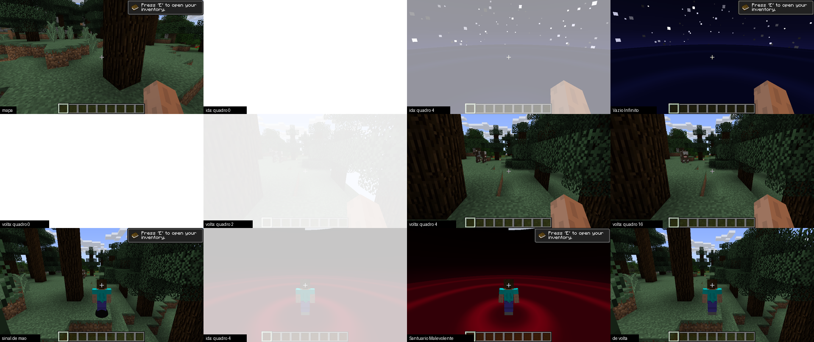

# Transporte: a ida para a arena e a volta

O dono quer uma expansão **instantânea**: sem tela de carregamento e sem buraco no mundo. Este documento descreve como
o mod faz isso e o que foi medido.

> Tudo aqui foi medido no **harness** (`dev/TransportHarness`): um cliente só, servidor integrado, renderização por
> software, sem placa de vídeo. Nada foi visto ainda no Crucible, com o modpack inteiro ou com dois jogadores. Esses
> pontos estão em [A verificar](#a-verificar).

## O problema

No 1.7.10, um teleporte longo dentro do mesmo mundo tem três custos:

1. **O servidor** precisa carregar (ou gerar) os chunks do destino e mandá-los, cinco por tick.
2. **O cliente fica parado** enquanto não recebe o chunk em que está (`EntityClientPlayerMP#onUpdate` só roda com o
   chunk carregado).
3. **O cliente remonta as malhas** de tudo o que está em volta, antes de desenhar.

Na volta, os mesmos três, para a cidade.

## A solução



### 1. A arena não tem nada para desenhar

A arena é feita de um único bloco, o `ryoikitenkai:veu` (`block/BlockVeil`): sólido, inquebrável e **invisível**
(tipo de renderização -1). A malha dos chunks da arena é vazia, então o custo 3 não existe na ida. O que o jogador vê
lá dentro (céu, chão, estruturas) é desenhado pelo cliente por cima, em `client/DomainRenderer`.

* **Forma** (`arena/ArenaShape`, sem classes do Minecraft): um disco de piso e uma casca em cúpula em volta de um
  interior de 13 blocos de raio (configurável de 6 a 14). A casca é fechada inclusive nas diagonais; um teste
  unitário "inunda" o interior e confere que nada vaza.
* **Tamanho:** o centro fica no canto comum de quatro chunks, e a arena inteira cabe nesses **quatro chunks**
  (2.496 blocos com raio 13).
* **Luz:** o piso (meta 1) emite luz 15. Quem está dentro fica iluminado igual de dia e de noite.
* **Contorno:** o cliente não desenha o contorno preto de seleção nesses blocos.

### 2. As arenas ficam longe, num terreno vazio

* **Onde** (`arena/ArenaSlots`): na mesma dimensão do conjurador, a partir de x = 200.000, z = 200.000, y = 120
  (config `arena.x`, `arena.z`, `arena.y`), uma vaga a cada 1.024 blocos. O número de vagas é o máximo de domínios
  simultâneos (config `dominio.maximo`, padrão 2).
* **Construção** (`arena/ArenaManager#prepare`): na primeira conjuração em cada dimensão, ou com `/ryoiki preparar`.
* **Sempre carregadas:** um ticket do ForgeChunkManager segura os quatro chunks de cada arena.
* **Terreno em volta apagado:** todos os chunks que um jogador na arena teria em vista são esvaziados, seis por tick,
  em segundo plano. Sem isso, cada teleporte faria o servidor carregar e mandar centenas de chunks de terreno que
  ninguém vê. Um chunk vazio é carregado e enviado quase de graça.
* **Trava de segurança:** o mod **não apaga** um chunk em que jogadores já estiveram (`inhabitedTime > 0`). Se a
  região estiver ocupada, a conjuração falha com um aviso para mudar as coordenadas.

### 3. Os chunks da arena chegam antes

No início do sinal de mão (25 ticks), o servidor manda os quatro chunks da arena, num pacote só
(`S26PacketMapChunkBulk`), para quem está perto o bastante para ser pego (raio + 12 blocos). O cliente 1.7.10 guarda
chunks recebidos mesmo longe do jogador. Quando o teleporte chega, o chão já está na memória: o custo 2 não existe.

### 4. O cliente guarda a cidade

Ao teleportar o jogador, o servidor manda descartar os chunks que ele deixou (um `S21PacketChunkData` de chunk inteiro
sem nenhuma seção). Um Mixin em `NetHandlerPlayClient#handleChunkData` **ignora esses descartes** para os chunks em
volta do ponto de onde o jogador saiu, enquanto ele está no domínio (`net/ChunkKeep`). Na volta, os dados da cidade
estão na memória.

* O servidor reenvia esses chunks depois do teleporte de volta (comportamento normal do jogo), o que atualiza qualquer
  bloco que tenha mudado nesse meio-tempo.
* 100 ticks depois do fim do domínio, o cliente descarta de verdade os chunks guardados que ficaram fora da vista
  (por exemplo, se o jogador morreu e renasceu em outro lugar).
* Trocar de mundo ou sair do servidor limpa tudo.

### 5. O flash cobre o corte

Um flash de tela inteira (3 ticks cheio, 11 sumindo) cobre a ida e a volta. Na ida ele é só estilo. Na volta ele
cobre a remontagem das malhas da cidade, que é o único custo que sobra.

### A ordem das mensagens

O canal `ryoiki:dom` (`net/DomainWire`) é de mensagens cruas, tratadas por um Mixin em
`NetHandlerPlayClient#handleCustomPayload`, na thread principal do cliente e na ordem de envio (o mesmo esquema do
Kunftig). O "você entrou" (`ENTER`) chega sempre antes do pacote de teleporte e dos descartes de chunk.

| Mensagem | Quando | Para quem |
|---|---|---|
| `WINDUP` | começo do sinal de mão | quem está a até 96 blocos |
| `ENTER` | o domínio abre | cada jogador pego, logo antes do teleporte |
| `DOME` | o domínio abre (e a cada segundo, para quem chegou depois) | quem está perto e ficou de fora |
| `EXIT` | fim do domínio, ou o jogador saiu dele | quem estava dentro |
| `DOME_END` | fim do domínio | quem viu o sinal de mão ou o domo |

## O que foi medido

Três execuções do harness, com terreno normal (floresta), distância de renderização 8, Java 8:

| Execução | Chão sob o jogador após o teleporte | Chunks no cliente (mapa → no domínio → de volta) |
|---|---|---|
| Sem Angelica, arenas já prontas | quadro 0, na ida e na volta | 289 → 578 (289 guardados) → 289 |
| **Com Angelica 2.2.45**, arenas já prontas | quadro 0, na ida e na volta | 289 → 578 (289 guardados) → 289 |
| Sem Angelica, primeira conjuração do mundo | quadro 0, na ida e na volta | 289 → 578 (289 guardados) → 289 |

* **Ida:** o jogador tem chão e pode se mover no primeiro quadro depois do teleporte, nas três execuções.
* **Volta:** nas capturas, o terreno à vista já está inteiro por baixo do flash no quadro 2 (com Angelica) e no
  quadro 4 (sem). Quando o flash some, a cidade está completa.
* **Parede:** andando 5 segundos contra a casca, o jogador para a 12,70 blocos do centro (raio 13) e não sai.
* **Servidor:** a conjuração custa de 0,1 a 9 ms (0,1 ms depois de aquecido). A primeira de cada mundo custa cerca de 80 ms, porque constrói a
  arena; `/ryoiki preparar` tira esse custo da primeira conjuração.
* **Esvaziar o terreno** em volta das duas arenas levou 160 ticks (8 s) em segundo plano.

Os tempos em milissegundos do relatório (dezenas de ms por quadro, um engasgo de 300 a 700 ms na volta) são da
renderização por software e não dizem nada sobre um PC com placa de vídeo. O que vale é a ordem dos acontecimentos.

Para repetir:

```bash
echo warm > run/client/ryoiki-harness      # ou "cold": conjura sem preparar as arenas antes
LIBGL_ALWAYS_SOFTWARE=1 xvfb-run -a -s "-screen 0 1280x720x24 +extension RANDR" \
    ./gradlew runClient -Pharness           # com -Pangelica para rodar com a Angelica
cat run/client/ryoiki-harness.txt
```

## O que acontece quando algo sai do roteiro

| Situação | O que o mod faz |
|---|---|
| O jogador sai do jogo dentro do domínio | É salvo no ponto de onde foi pego |
| O servidor para normalmente | Todos os domínios terminam antes de salvar |
| O servidor cai | O ponto de volta fica gravado no jogador; no próximo login ele é mandado de volta |
| O jogador morre lá dentro | Sai do domínio e renasce onde o servidor mandar |
| O conjurador morre, sai ou deixa a arena | O domínio termina e todos voltam |
| Outro teleporte tira alguém da arena | Essa pessoa sai do domínio (sem ser puxada de volta) |
| Pérola do ender lá dentro | Cancelada |
| O jogador está montado | Desmonta antes de ir |

Tudo isso está no código (`domain/DomainManager`) e **a verificar** no jogo.

## A verificar

* **No Crucible:** o teleporte dispara os eventos do Bukkit; plugins de proteção, de borda de mundo ou de combate podem
  cancelá-lo. `/home`, `/tpa` e `/spawn` dentro do domínio.
* **A região x = 200.000** no mundo real do servidor: se existe borda, se alguém já esteve lá.
* **O custo de esvaziar o terreno** com o gerador de mundo do modpack (aqui foi o gerador padrão).
* **A volta num PC de verdade**, com a Angelica e com um shaderpack: se o flash de 14 ticks cobre a remontagem.
* **Dois ou mais jogadores:** quem é pego, a posição relativa, o domo visto de fora, quem chega depois.
* **Mobs e itens** que estavam no raio: hoje ficam onde estão (só jogadores são levados).
* **Voz** (AkashicVoiceChat): quem está na arena some da voz de quem ficou (ver o handoff).
* **Golpes de outros mods** que atravessam ou quebram blocos, contra a casca.
* **Mods de minimapa** (o terreno vazio e a arena a 200.000 blocos podem aparecer no mapa).
* **Chuva e som de chuva** dentro da arena (a cúpula é sólida, deve bloquear).
