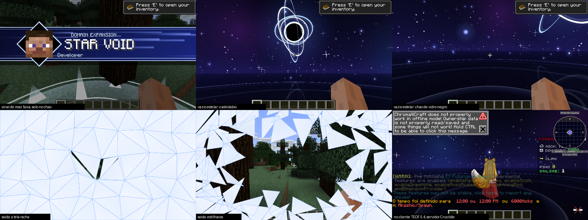

# Visual dos domínios

O que o jogador vê, do sinal de mão ao fim do domínio. Tudo é **desenhado por código** no cliente (`client/`): não há
modelo nem textura no mod (os sons são sintetizados, ver "Som"). A arena é feita de blocos invisíveis, então o cliente desenha o domínio inteiro.

> **Sobre a referência.** O dono pediu o visual "igual ao do Jujutsu Shenanigans". O agente não reproduz a arte, os
> personagens nem as cenas de um jogo ou de um anime existentes (inclusive o santuário de bocas e chifres da
> referência que ele mandou); o que foi feito é um **visual próprio** com a mesma estrutura dramática (entrada com
> gesto, domo, interior com um santuário central, cortes, estilhaço). Os dois domínios se chamam, na tela, **Vazio
> Estelar** e **Santuário Carmesim** (os nomes estão em `assets/ryoikitenkai/lang/`, é só trocar).




## A sequência

| Momento | O que aparece | Onde |
|---|---|---|
| Sinal de mão (25 ticks) | Uma **faixa inclinada** cruza a tela de quem está perto (o conjurador e quem está a até raio + 12 blocos). Nela, o **boneco do conjurador com a skin dele faz o gesto**: ergue os braços do repouso até o sinal do domínio (uma mão diante do rosto no vazio, as duas erguidas e unidas diante da boca, espelhadas, no santuário), com um clarão no instante em que o sinal se completa. Ao lado, o nome do domínio e o do jogador, e riscos de velocidade. Entra em 5 ticks e sai nos 4 últimos | `CutIn` |
| | **A câmera sobre o boneco** (`CutIn#shot`): nos dois domínios, **três planos com cortes secos** aos 6 e aos 12 ticks, com um clarão a cada corte. O boneco está no lugar desde o primeiro quadro e a faixa entra por trás dele. **Vazio:** 1) de costas e de baixo, o corpo inteiro, o braço começando a subir; 2) close na mão que sobe, de lado e inclinado; 3) close frontal do rosto com a mão diante dele, com um tranco quando o sinal se completa. Fundo: braços de luz girando e estrelas em riscos. **Santuário:** 1) de cima e de lado, a cabeça baixa; 2) do chão, olhando para cima, as mãos se unindo em primeiro plano; 3) de frente e **reto** (sem giro nem inclinação lateral), com a câmera acima olhando para baixo: os olhos por cima das mãos unidas. Fundo: uma lua, anéis sobre água vermelha, cortes de luz e brasas. A câmera mira a cabeça ou a mão **do próprio modelo** (medidas no mesmo quadro, numa passada que não desenha nada), e é ela que gira, não o modelo. Com a skin comum (sem o Futura3D) os ângulos são os mesmos, mas a mira é sempre a cabeça | `CutIn` |
| | Um **selo** no chão sob o conjurador (anéis e doze raios que giram) e uma onda que corre até onde o domo vai ficar | `DomainRenderer#seal` |
| | O **domo** cresce do conjurador, devagar e depois de uma vez | `DomainRenderer` |
| Entrada | Flash branco (cobre o teleporte) | `DomainRenderer#onOverlay` |
| Interior | Céu, reflexo, chão e o que há na arena, conforme o domínio (abaixo) | `DomainSky`, `DomainLook` |
| Para quem ficou de fora | O domo (branco ou preto) com uma linha de luz onde encosta no chão | `DomainRenderer` |
| Saída | A tela fica inteira na cor do domínio, **racha** e os **estilhaços** voam, com a cidade atrás. Um tranco na câmera | `Shatter`, `fx/ShardField` |

## Vazio Estelar (`VoidLook`)

* **Céu:** espaço profundo, 1.100 estrelas que piscam (algumas com brilho em cruz), cinco nebulosas.
* **Astrolábio:** ao norte, um núcleo escuro num aro branco com quatro anéis girando, cada um no seu plano. Abre nos
  primeiros 45 ticks.
* **Chão:** vidro negro. O céu inteiro é desenhado de novo de cabeça para baixo, mais fraco, e o chão é translúcido
  por cima: o reflexo é de verdade. Anéis de luz correm do centro; uma linha marca a borda do domínio.
* **No ar:** 110 pontos de luz subindo devagar.

## Santuário Carmesim (`ShrineLook`)

* **Céu:** preto, com o horizonte em brasa e uma **lua de sangue** baixa (refletida na água).
* **Chão:** água vermelha, com ondas que saem do centro.
* **O santuário:** no **meio da arena**, atrás do conjurador (que cai 13 blocos à frente da porta, de costas para
  ela). Um salão quadrado de 10 blocos de lado sobre uma base em degraus, com a porta acesa por dentro, três telhados
  de beirais virados para cima e uma agulha com três anéis de luz; uma corda grossa com tiras de papel na frente,
  um estandarte de cada lado e lanternas de pedra. A lua fica atrás dele.
  * **É sólido.** No sinal de mão o servidor ergue o salão em blocos invisíveis (`arena/ShrineCore`, paredes e teto,
    girado para onde o conjurador olhava) e o desfaz quando o domínio acaba. Ninguém cai dentro dele.
  * É um desenho próprio. O dono pediu o santuário da referência (bocas na porta, chifres, caveiras) "100%": isso o
    agente não reproduz.
* **Em volta:** doze **portais** em anel, fora da parede, cada um com duas lanternas que tremulam;
  **torres** negras no horizonte; névoa vermelha rasteira em faixas; brasas subindo.
* **Cortes:** a cada 4 ticks um risco branco cruza a arena num instante e deixa um rastro vermelho que some
  (`fx/SlashField`). A posição de cada corte sai do número do domínio e do tempo, então **todos os clientes veem os
  mesmos cortes sem nenhuma mensagem**. Cada corte dá um tranco na câmera. Por enquanto é só visual: não causa dano.

## Som (`DomainSounds`, `SoundCues`)

Cada momento do domínio tem um som, tocado no cliente junto com o que se vê:

| Som (`<nome>.ogg`) | Quando | Onde | Canais |
|---|---|---|---|
| `sinal` | começo do sinal de mão | no conjurador (ouve-se a 48 blocos) | mono |
| `vazio_voz`, `santuario_voz` | junto com o sinal: a fala do conjurador. **No jar é silêncio** | no conjurador | mono |
| `faixa_corte` | em cada corte de câmera da faixa (ticks 6 e 12) | no ouvido de quem vê a faixa | estéreo |
| `vazio_entrada`, `santuario_entrada` | o domínio se fecha | no ouvido de quem entrou; no domo, para quem ficou fora | mono |
| `vazio_ambiente`, `santuario_ambiente` | em laço enquanto se está dentro, com entrada e saída suaves | no ouvido | estéreo |
| `santuario_corte` | a cada 8 ticks, junto com o tremor, com o tom variando | no ouvido | estéreo |
| `saida` | o domínio se quebra | no ouvido | estéreo |
| `domo` | em laço enquanto o domo está de pé, para quem está fora | no domo (ouve-se a 64 blocos) | mono |

Os eventos estão em `assets/ryoikitenkai/sounds.json` (categoria "ambiente" para os dois laços de dentro, "jogadores"
para o resto, então os controles de volume do jogo valem). Os sons do jar são **sintetizados** por
`tools/sons/gerar.py` (numpy + ffmpeg): servem para o mod não ficar mudo.

**Os sons do dono:** um arquivo `config/ryoikitenkai/sons/<nome>.ogg` no cliente substitui o do jar (`OwnerSounds`, um
resource pack sobre essa pasta, lido ao abrir o jogo e no F3+T). Um resource pack comum com
`assets/ryoikitenkai/sounds/<nome>.ogg` também funciona. O que toca de um lugar do mundo **precisa ser mono** (o jogo
não atenua estéreo com a distância). `tools/sons/converter.py` faz a conversão a partir de uma lista
(`nome | origem | início | duração`): corta, normaliza o volume, põe nos canais certos e grava com o nome certo. Ver
[`tools/sons/LEIA-ME.md`](../tools/sons/LEIA-ME.md).

Verificado no cliente de teste com o OpenAL gravando num arquivo: os dois domínios inteiros, e um arquivo do dono
substituindo o do jar. **A verificar:** ouvir num PC de verdade (volumes, a emenda dos laços, se os cortes do
santuário cansam), o som posicional com dois jogadores, e o modpack completo.

## A arte do dono na faixa

A faixa tem um espaço, à direita, para uma imagem ou uma animação curta de cada domínio. **O mod não traz nenhuma**:
quem monta o modpack põe o arquivo na pasta de configuração **do cliente**. Há dois jeitos:

```
config/ryoikitenkai/faixa/vazio.gif              um GIF animado, tocado na velocidade dele
config/ryoikitenkai/faixa/santuario.gif

config/ryoikitenkai/faixa/vazio/00.png, 01.png...    ou uma pasta de quadros PNG, na ordem dos nomes
config/ryoikitenkai/faixa/vazio/fps.txt              (opcional; um número, 12 se faltar)
```

Toca em laço enquanto a faixa está na tela (até 96 quadros, até 1.024 pixels de lado). Se houver o GIF e a pasta, vale
o GIF. Sem nenhum dos dois, a faixa fica como antes. O mod lê na primeira vez que a faixa aparece, então trocar o
arquivo pede reabrir o jogo. Só GIF e PNG: WebP não é lido.

O que vai ali é escolha e responsabilidade de quem monta o modpack. O dono pediu duas cenas do anime e insistiu; o
agente não as embutiu no mod nem as usou nas amostras (as capturas mostram uma animação de teste).

## Como é feito

* **O céu entra no lugar do céu do jogo.** Enquanto o jogador está no domínio, o cliente troca o `IRenderHandler` de
  céu do mundo pelo do domínio, e os de nuvem e de chuva por um que não desenha nada (`DomainSky`); ao sair, devolve
  o que havia. O céu é desenhado em volta da câmera, antes de tudo, então fica atrás de tudo e a qualquer distância.
  Com distância de renderização menor que 4 chunks o jogo não desenha céu: aí o mod desenha no fim do quadro, só onde
  não há nada na frente.
* **A neblina** do jogo passa a ter a cor do domínio (`EntityViewRenderEvent.FogColors`).
* **O tremor** vira a entidade da câmera uns graus só durante o desenho de cada quadro e desfaz logo depois
  (`CameraShake`). Nada vai para o servidor.
* **A cena fica atrás do conjurador.** A mensagem de entrada leva para onde o conjurador olhava quando o domínio
  abriu; céu, chão e estruturas são girados por esse ângulo, igual para todos lá dentro.
* **O gesto usa o modelo do jogador.** Onde o 3D Futura Engine desenha os jogadores (o mod de modelos da rede, no
  repositório YesSteveModel), o conjurador faz o sinal com o **próprio modelo**: `FuturaBridge` chama, por reflexão,
  `FuturaModels.setBonePose` (API 6 do Futura3D) a cada quadro, com a rotação de cada osso como num arquivo de
  animação. Isso vale **na faixa** (o jogador é desenhado ali como no inventário, da cintura para cima, enquadrado
  pela cabeça do modelo) **e no mundo** (durante o sinal e nos primeiros 34 ticks do domínio).
  * Ossos posados: `RightArm`, `RightForeArm`, `LeftArm`, `LeftForeArm`, `Head` (nomes padrão dos modelos) e os dedos
    `right_fg`, `right_ffg`, `left_fg`, `left_ffg`, `left_dmz` (os quatro dedos como um bloco em duas juntas, e o
    polegar). Um modelo que não tem um osso simplesmente não o move.
  * Os ângulos foram acertados num modelo de teste que o dono mandou (uma personagem de quimono, CC BY-NC-SA, **fora
    do repositório**) e conferidos no modelo padrão do modpack. Em outros modelos o gesto pode sair diferente.
  * **Dedos um a um não existem** nesses modelos: os quatro dedos são um osso só. O sinal é feito com os braços, as
    mãos e esse bloco.
* **Sem o Futura3D** (ou com um mais antigo que a API 6), a faixa mostra um `ModelBiped` do próprio jogo com a skin
  comum do conjurador, com os braços posados à mão.


* **Um domínio novo** é uma classe que implementa `DomainLook` (céu, chão, o que há na arena e as cores da faixa e
  dos estilhaços) e uma entrada em `DomainType`.

## Verificado e a verificar

* **Verificado** em 2026-11-12: no cliente de desenvolvimento com a Angelica 2.2.45, e no cliente **TEOF 5.4**
  completo conectado ao Crucible da rede (as últimas capturas de cada imagem acima). Sempre com renderização por
  software.
* **A verificar:**
  * com placa de vídeo e com um **shaderpack** ligado (os shaders da Angelica mudam o céu e podem ignorar o céu do
    mod);
  * o **custo em quadros por segundo** num PC modesto (são alguns milhares de triângulos por quadro, sem textura);
  * a faixa de entrada em telas muito largas ou com a escala da interface no máximo;
  * skins em alta resolução (HD);
  * o gesto em outros modelos do servidor (cada modelo tem o seu repouso de braços e os seus ossos de dedos);
  * o que os outros jogadores veem (a faixa, o selo, o domo): as capturas são de um jogador só;
  * o minimapa (JourneyMap) continua mostrando as coordenadas da arena.

## O que falta para o visual

* **Som:** os efeitos existem (seção "Som"), sintetizados. Voz e trilha de cada domínio ficam para os arquivos do dono; o choque de domínios ainda não tem som.
* **Efeitos de jogo:** os cortes do santuário e a paralisia do vazio são só imagem.
* **O sinal de mão no mundo sem o Futura3D:** com a skin comum o jogador fica parado (o gesto só aparece na faixa).
* **Choque de domínios.**
