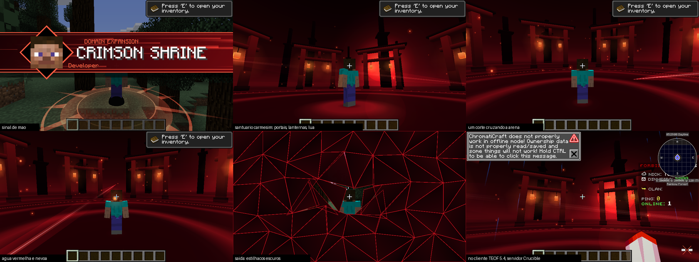
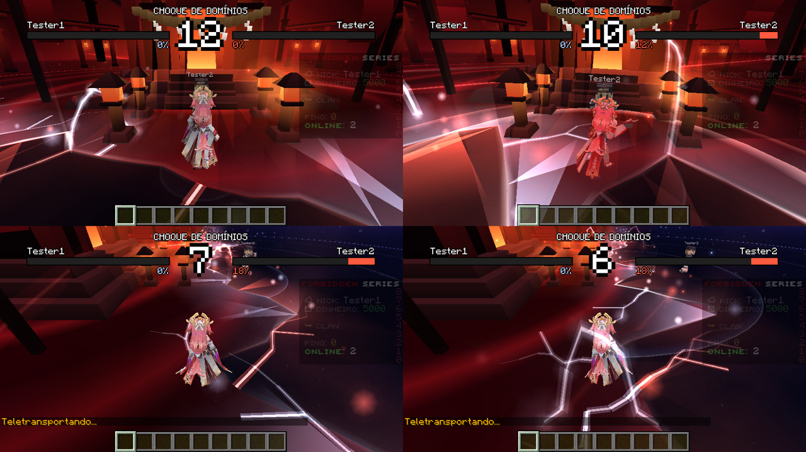
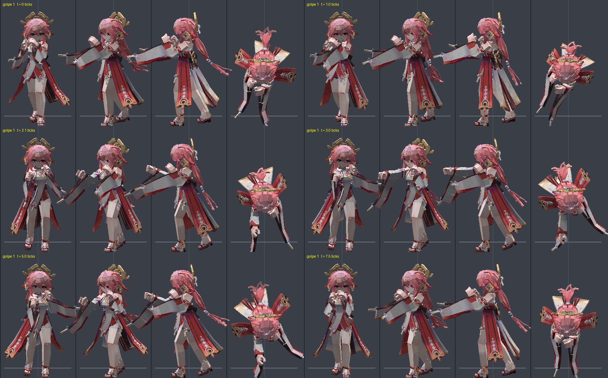
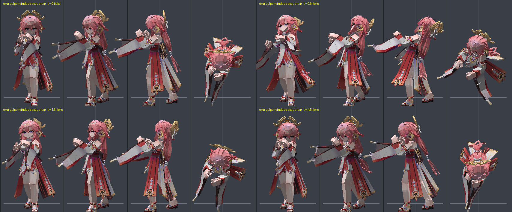
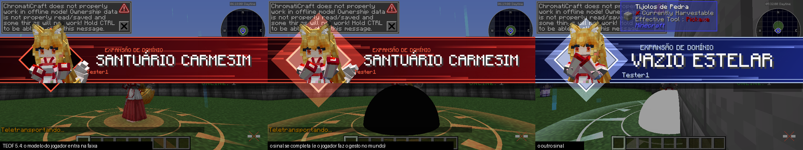

# Visual dos domínios

O que o jogador vê, do sinal de mão ao fim do domínio. Tudo é **desenhado por código** no cliente (`client/`): não há
modelo, textura nem som no mod (os sons são arquivos do dono, ver "Som"). A arena é feita de blocos invisíveis, então o cliente desenha o domínio inteiro.

> **Sobre a referência.** O dono pediu o visual "igual ao do Jujutsu Shenanigans". O agente não reproduz a arte, os
> personagens nem as cenas de um jogo ou de um anime existentes (inclusive o santuário de bocas e chifres da
> referência que ele mandou); o que foi feito é um **visual próprio** com a mesma estrutura dramática (entrada com
> gesto, domo, interior com um santuário central, cortes, estilhaço). Os dois domínios se chamam, na tela, **Vazio
> Estelar** e **Santuário Carmesim** (os nomes estão em `assets/ryoikitenkai/lang/`, é só trocar).




## A sequência

| Momento | O que aparece | Onde |
|---|---|---|
| Sinal de mão (25 ticks) | Uma **faixa inclinada** cruza a tela de quem está perto (o conjurador e quem está a até raio + 12 blocos). Nela, o **boneco do conjurador com a skin dele faz o gesto**: ergue os braços do repouso até o sinal do domínio (uma mão diante do rosto no vazio, as duas erguidas e unidas diante da boca, espelhadas, no santuário), com um clarão no instante em que o sinal se completa. Ao lado, o nome do domínio e o do jogador, e riscos de velocidade. Entra em 5 ticks e sai nos 4 últimos | `CutIn` |
| | **A câmera sobre o boneco** (`CutIn#shot`): nos dois domínios, **três planos com cortes secos** aos 6 e aos 12 ticks, com um clarão a cada corte. O boneco está no lugar desde o primeiro quadro e a faixa entra por trás dele. **Vazio:** 1) de costas e de baixo, o corpo inteiro, o braço começando a subir; 2) close na mão que sobe, de lado e inclinado; 3) close frontal do rosto com a mão diante dele, com um tranco quando o sinal se completa. Fundo: braços de luz girando e estrelas em riscos. **Santuário:** 1) de cima e de lado, a cabeça baixa; 2) do chão, olhando para cima, as mãos se unindo em primeiro plano; 3) de frente e **reto** (sem giro nem inclinação lateral), com a câmera acima olhando para baixo: os olhos por cima das mãos unidas. Fundo: uma lua, anéis sobre água vermelha, cortes de luz e brasas. A câmera mira a cabeça ou a mão **do próprio modelo** (medidas no mesmo quadro, numa passada que não desenha nada), e é ela que gira, não o modelo. Com a skin comum (sem o Futura3D) os ângulos são os mesmos, mas a mira é sempre a cabeça | `CutIn` |
| | Um **selo** no chão sob o conjurador (anéis e doze raios que giram) e uma onda que corre até onde o domo vai ficar | `DomainRenderer#seal` |
| | O **domo** cresce do conjurador, devagar e depois de uma vez | `DomainRenderer` |
| Entrada | Flash branco (cobre o teleporte) | `DomainRenderer#onOverlay` |
| Interior | Céu, reflexo, chão e o que há na arena, conforme o domínio (abaixo) | `DomainSky`, `DomainLook` |
| Para quem ficou de fora | O domo (branco ou preto) com uma linha de luz onde encosta no chão | `DomainRenderer` |
| Saída | A tela fica inteira na cor do domínio, **racha** e os **estilhaços** voam, com a cidade atrás. Um tranco na câmera | `Shatter`, `fx/ShardField` |

## Vazio Estelar (`VoidLook`)

* **Céu:** espaço profundo, 1.100 estrelas que piscam (algumas com brilho em cruz), cinco nebulosas.
* **Astrolábio:** ao norte, um núcleo escuro num aro branco com quatro anéis girando, cada um no seu plano. Abre nos
  primeiros 45 ticks.
* **Chão:** vidro negro. O céu inteiro é desenhado de novo de cabeça para baixo, mais fraco, e o chão é translúcido
  por cima: o reflexo é de verdade. Anéis de luz correm do centro; uma linha marca a borda do domínio.
* **No ar:** 110 pontos de luz subindo devagar.

## Santuário Carmesim (`ShrineLook`)

* **Céu:** preto, com o horizonte em brasa e uma **lua de sangue** baixa (refletida na água).
* **Chão:** água vermelha, com ondas que saem do centro.
* **O santuário:** no **meio da arena**, atrás do conjurador (que cai 13 blocos à frente da porta, de costas para
  ela). Um salão quadrado de 10 blocos de lado sobre uma base em degraus, com a porta acesa por dentro, três telhados
  de beirais virados para cima e uma agulha com três anéis de luz; uma corda grossa com tiras de papel na frente,
  um estandarte de cada lado e lanternas de pedra. A lua fica atrás dele.
  * **É sólido.** No sinal de mão o servidor ergue o salão em blocos invisíveis (`arena/ShrineCore`, paredes e teto,
    girado para onde o conjurador olhava) e o desfaz quando o domínio acaba. Ninguém cai dentro dele.
  * É um desenho próprio. O dono pediu o santuário da referência (bocas na porta, chifres, caveiras) "100%": isso o
    agente não reproduz.
* **Em volta:** doze **portais** em anel, fora da parede, cada um com duas lanternas que tremulam;
  **torres** negras no horizonte; névoa vermelha rasteira em faixas; brasas subindo.
* **Cortes:** a cada 4 ticks um risco branco cruza a arena num instante e deixa um rastro vermelho que some
  (`fx/SlashField`). A posição de cada corte sai do número do domínio e do tempo, então **todos os clientes veem os
  mesmos cortes sem nenhuma mensagem**. Cada corte dá um tranco na câmera. Por enquanto é só visual: não causa dano.

## Choque de Domínios (`ClashHud`, `ClientDomain#shown`)



* **Sinal do rival:** quem responde a um domínio ganha a própria faixa e a própria voz, por cima do que estiver na
  tela (o sinal dele pode terminar já dentro da arena).
* **Durante, a fusão** (`Scene`, `fx/Frontier`, `ClashFront`): os dois domínios **dividem a arena e brigam por
  ela**. O dono pediu a fusão em 2026-11-13 e recusou a primeira versão (uma linha reta com um corte seco) como
  "pobre e medíocre": quer os efeitos dos dois domínios **se misturando e se repelindo**, sem linha. O que há:

  * **A frente** (`Frontier`, lógica pura com teste) não é uma linha: é a soma de ondas longas e lentas, ondas
    curtas e rápidas em sentidos opostos, e **línguas** arredondadas em que um domínio entra no outro e o outro
    nele, lado a lado, crescendo e cedendo (até 5,2 blocos do lugar médio). Fica em torno da costura da arena
    (o meio, num Vazio; diante da porta do salão, num Santuário).
  * **A frente responde à luta:** quem está à frente no placar **empurra** a frente para o chão do outro (até 9
    blocos no meio, menos junto às paredes), e ela segue o placar aos poucos; **cada golpe que acerta dá um
    tranco** nela inteira e solta duas corcovas que correm ao longo dela a partir de onde bateu.
  * **Cada cenário só existe do seu lado**, com exatidão: chão e estruturas são cortados ao longo da frente. Um
    corte do OpenGL é reto e a frente não é, então cada cenário é montado uma vez numa lista e redesenhado para
    cada um dos 56 trechos da frente, entre duas paredes e do seu lado do trecho (`Scene#clip`). O cenário do rival
    é desenhado **virado de frente para a frente**, para o que ele tem ficar no chão dele.
  * **Os céus se misturam**, sem corte: as cores de fundo dos dois são uma esfera só, cada direção uma mistura
    conforme o quanto aquele pedaço de céu está além da frente, com uma turbulência lenta, de modo que a borda
    deriva; as luzes de cada céu (estrelas, lua, astrolábio) somem em seis degraus pela mesma faixa
    (`DomainSky#fused`).
  * **Repelindo-se** (`ClashFront`): uma linha quente corre pela frente em **contas de luz** (dois trens em
    velocidades diferentes, escuro entre eles), com uma parede baixa de luz sobre ela; **descargas** saltam dela
    para um chão ou para o outro, tremendo enquanto duram; **faíscas** são atiradas para os dois lados e caem;
    o chão **racha** a partir dela, com um ramo, na cor do domínio que empurra.
  * **Misturando-se:** a luz de cada domínio fica **derramada no chão do outro** por uns 4 blocos além da
    frente, respirando; **partículas** de cada um atravessam devagar e vão tomando a cor do outro, menores, até
    sumir; colunas tênues de brilho sobem da frente até a faixa onde os céus se misturam.
  * **Um golpe que acerta** abre um anel no chão a partir de onde empurrou a frente, e esquenta a frente ali.
  * A luz da frente é quase apagada **bem onde a câmera está** (os conjuradores começam o choque em cima dela, e
    luz somada a um palmo do olho é tela branca). Perto da frente a névoa mistura as cores dos dois. Para quem está
    fora, **o domo fica preto**.

  Tudo sai da forma da frente, do tempo e do número do domínio: todos na arena veem o mesmo.
* **Na tela, no topo:** "CHOQUE DE DOMÍNIOS", o **contador** grande de 15 a 0 (vermelho e pulsando nos últimos 5 s) e,
  dos lados, a **barra de cada conjurador** com nome e porcentagem, na cor do domínio dele, enchendo em direção ao
  meio. Fica no topo porque embaixo estão a vida, a armadura e a barra de itens.
* **Resolução:** clarão na cor do vencedor e tremor; o domínio do vencedor recomeça e toma a arena inteira. Se
  quem venceu foi o rival, o cenário dele **fica onde estava** durante o choque (virado), sem pular de lugar. No
  empate, a quebra de sempre.

### Os golpes do choque (`ComboChain`, `BlowPose`, `ClientDomain.Blow`)

No choque, cada clique dos dois conjuradores é um golpe de uma **cadeia de quatro**. O dono pediu este trabalho
**meticuloso e uma peça por vez**: cada golpe é um movimento do corpo inteiro, calculado, e só se passa ao seguinte
quando o anterior está bom. **Estado: a guarda e o golpe 1 estão feitos; os golpes 2, 3 e 4 são provisórios** (uma
pose cada, tomada pelo corpo todo de uma vez), só para a cadeia existir.

**Ordem das peças** (uma por vez; cada uma só começa com a anterior aprovada pelo dono):

1. ~~a guarda e o golpe 1 (direto de direita)~~ feito;
2. ~~levar um golpe~~ feito (abaixo);
3. os kits, que o dono quer **diferentes por domínio e com golpes de perna**. Proposta do agente, a aprovar:

   | | Vazio Estelar (leve, de longe, preciso) | Santuário Carmesim (pesado, de perto, bruto) |
   |---|---|---|
   | 1 | direto de direita (o que está feito) | gancho de esquerda ao corpo |
   | 2 | jab de esquerda | cruzado de direita de cima para baixo |
   | 3 | chute lateral alto, de direita | joelhada |
   | 4 (finalizador) | chute giratório de costas | chute descendente (calcanhar), que derruba |

4. cair no chão e levantar, junto com o primeiro finalizador.

**O que cada eixo faz** (medido no modelo de teste com o visor de quatro vistas; graus como num arquivo de animação):

| Eixo | Positivo |
|---|---|
| X | inclina o corpo para a frente; leva braço ou perna **para trás** (negativo: para a frente); dobra o joelho (`LowerLeg`) e o cotovelo é o contrário (`ForeArm` negativo dobra); aponta os dedos do pé para baixo |
| Y | gira para a **direita do próprio modelo** (o ombro esquerdo vem à frente); num braço erguido, leva-o para a direita |
| Z | inclina o tronco e a cabeça para a **esquerda** do modelo; abre o braço e a perna **direitos** para fora (os esquerdos são espelhados) |

Ossos usados (`BlowPose.BONES`): `AllBody` (quadril e tudo acima e abaixo), `UpBody` (tronco), `AllHead`, `RightArm`,
`RightForeArm`, `LeftArm`, `LeftForeArm`, `RightLeg`, `RightLowerLeg`, `RightFoot` e os três da perna esquerda.

**A guarda** (de onde todo golpe sai e para onde volta): lado esquerdo à frente, corpo 20° fora da linha, joelhos
dobrados com o peso entre as pernas, punho de trás no queixo e o da frente um pouco adiante.

**Golpe 1, o direto de direita** (10 ticks; o punho chega no tick 3):



| Fase | Ticks | O que acontece |
|---|---|---|
| Antecipação | 0 a 1 | o corpo gira 5° a mais para trás, o peso vai para a perna de trás, o punho recolhe |
| Golpe | 0,9 a 3 | **em cadeia**: o quadril gira primeiro (0,9 a 2,4), o tronco depois (1,2 a 2,7), o braço por último (1,5 a 3). No fim o quadril passou 32° pela linha e o tronco mais 22°; o peso está na perna da frente e a de trás, esticada |
| Retorno | 4 a 9,2 | na ordem inversa: o braço volta primeiro, o quadril por último |

Três coisas são **calculadas a cada instante, não posadas**, e têm teste (`BlowPoseTest`):

* **o punho anda em linha reta** do queixo ao alvo: ombro e cotovelo são resolvidos para isso (dois segmentos
  iguais), em vez de cada um girar por conta própria, o que levava o punho num arco para cima;
* **a cabeça desfaz o giro do corpo**: o olhar fica no alvo (a menos de 3,5°) enquanto quadril e tronco giram;
* **os pés ficam no chão**: a sola do pé da frente fica nivelada e apontada para o alvo o tempo todo; o pé de trás
  gira sobre a ponta (de 42° para 12°) e o calcanhar sobe (de 8° para 26°) conforme o quadril vem.

**Levar um golpe** (`BlowPose#struck`, 10 ticks):



O corpo de quem leva é **lançado e volta como uma mola amortecida** (`BlowPose#recoil`): chega ao máximo em meio
tick, volta ao ponto de partida aos 2,75 ticks, passa 21 % para o outro lado (o corpo se segurando) e assenta por
volta do tick 8. No máximo:

* a cabeça vai 24° para trás e 20° para o lado oposto ao do golpe, com 6° de tombo;
* o tronco recua 20° **na linha do golpe** e 5° para o lado, e gira 10°. O corpo fica virado em relação a essa
  linha (20° na guarda, mais no meio de um golpe), então o recuo é repartido entre as duas inclinações do tronco
  conforme o giro em que ele está: sem isso a cabeça saía para o lado errado;
* a guarda abre (braços 10° a 14° para trás e para fora, cotovelos 26° a 30° mais abertos) e o peso cai na perna de
  trás;
* as solas não saem do lugar: cada pé desfaz o que foi somado acima dele.

A reação é **somada à pose em que o corpo estiver** (a guarda ou um golpe próprio), e é espelhada conforme a mão que
bate (golpes ímpares vêm da esquerda de quem leva). Por enquanto é só visual: levar um golpe não interrompe a
cadeia de quem leva.

**As regras dos dois combatentes** (`ClashInput`, só para os dois conjuradores e só durante o choque; ver
[`PLANO-COMBATE.md`](PLANO-COMBATE.md), fase A):

* **Um clique é um golpe, e mais nada.** O clique é tomado antes de o jogo vê-lo e respondido com um balanço de
  braço, que é o que o servidor lê como golpe. O clique do Minecraft faria três coisas que quebram um combo: bater
  no outro do jeito dele (e, correndo, dar recuo no alvo, cortar 40 % da velocidade de quem bate e **desligar a
  corrida de quem bate**, no próprio cliente, antes de o servidor poder dizer não), começar a quebrar o bloco na
  mira, e balançar o braço sem parar enquanto o botão fica apertado num bloco.
* **Sem recuo nem tranco de dano do Minecraft.** Quem leva o golpe não é empurrado nem tem a câmera sacudida pelo
  jogo: medido com três golpes acertando, o alvo não saiu do lugar. O que conta o golpe é nosso: a reação do corpo,
  o clarão, um vermelho curto em quem leva (para quem vê) e o som de dano. Só o quarto golpe move o outro, e esse
  arremesso é nosso.
* **Os dois correm o tempo todo, para qualquer lado.** O jogo encerra a corrida que não é para a frente; a cada
  tick, depois que ele decide e antes de mover o jogador, a corrida é recolocada (`EntityPlayerRunMixin`). Medido
  em sobrevivência: fora do choque, andar para trás dá 0,22 bloco por tick; no choque, 0,28 para trás, de lado e
  para a frente.
* **Não quebram bloco.** No cliente o clique nem chega ao bloco; no servidor, clicar e quebrar são recusados.
* **Os outros no domínio ficam como no Minecraft:** andam, e levam dano e recuo normais entre si. Ninguém fere
  os dois combatentes de fora.

**No jogo:** a pose entra em 1,5 tick e o lutador fica na guarda enquanto a cadeia pode continuar (16 ticks), saindo
em 4; um golpe emenda no seguinte em 2 ticks, de onde o corpo estiver. O acerto é decidido **quando o punho chega**
(3 ticks depois do clique), não no clique: é aí que vêm o clarão no peito de quem leva, o tranco, o tremor e o
som.

* **Ritmo:** um golpe a cada 6 ticks; um clique até 4 ticks adiantado fica guardado; 18 ticks sem golpear e a cadeia
  volta ao primeiro; depois do quarto, 14 ticks de recuperação.
* **Acerto:** vale o rival a até 3,6 blocos e dentro de 60° da direção do olhar (ou colado). Cada um enche 6,25 %.
* **Movimento:** cada golpe dá um passo à frente (maior no quarto), e o quarto arremessa o rival.
* **Som (opcional):** `golpe.ogg` e `impacto.ogg` em `config/ryoikitenkai/sons/`.
* **Como trabalhar num golpe:** no harness, `turn guard`, `turn <golpe> <tick>` e `turn struck <tick>` (negativo: do outro lado) mostram o modelo de frente, de três
  quartos, de perfil e de cima; com `ryoiki-bones.txt` na pasta do jogo (linhas `<osso> <x> <y> <z>`), `turn on`
  mostra essa pose crua.

Verificado com dois clientes no servidor de teste: rival vencendo por tempo e por barra cheia, anfitrião vencendo por
barra cheia, empate, resposta durante o sinal de mão e depois de o domínio abrir. O golpe 1 e a reação a levar golpe foram vistos quadro a quadro no modelo de teste e rodaram num choque com dois
clientes. **A verificar:** a
sensação do combo com jogadores de verdade (ritmo, alcance, força do arremesso), os golpes em outros modelos (ossos
com outros nomes ou outra pose de repouso), a fusão com placa de vídeo de verdade (custo: cada cenário é redesenhado 58 vezes a partir de uma lista) e com
shaderpack (os planos de corte e as listas são da pipeline fixa do OpenGL; um shaderpack pode ignorá-los, e
`-Dryoiki.fusionLists=false` desliga as listas), quem assiste de fora perto do domo, mais de um jogador pego
além dos dois conjuradores, e o choque em sobrevivência com armas e habilidades de outros mods.

## Som (`DomainSounds`, `SoundCues`, `OwnerSounds`)

**O mod não traz som nenhum** (decisão do dono: só a trilha dele). Cada som é um `<nome>.ogg` em
`config/ryoikitenkai/sons/` do cliente; `OwnerSounds` é um resource pack sobre essa pasta que também escreve o
`sounds.json`, com um evento para cada arquivo presente. O que não tem arquivo não toca e não gera aviso no log.

* **A trilha da expansão:** `vazio_trilha` e `santuario_trilha` tocam uma vez, em estéreo, do sinal de mão ao fim da
  quebra (16,45 s e 20,45 s), para o conjurador e quem vê a faixa. Some em meio segundo se o domínio acabar antes ou
  se o jogador não for pego.
* **A voz:** `vazio_voz` e `santuario_voz` tocam uma vez, em estéreo, no primeiro tick do sinal de mão, por cima da
  trilha, para os mesmos jogadores.
* **O choque:** `clash_trilha`. Quando o choque começa (`DomainWire.CLASH`), a trilha do domínio some em 0,5 s e a
  do choque começa, para quem está no domínio e quem está a até raio + 12 blocos do domo; no fim do choque
  (`CLASH_END`, o fim do domínio, ou o jogador de fora se afastar) ela some em 0,5 s.
* **A música do jogo** (`MusicHush`): enquanto uma trilha do dono toca, a música que estava tocando é parada e
  nenhuma começa (categoria "música"). Depois o jogo volta a tocar no tempo dele, uma faixa nova.
* **Por momento, opcionais:** `sinal` (no conjurador, mono), `faixa_corte`, `<domínio>_entrada` (mono; do domo para
  quem está fora), `<domínio>_ambiente` (laço), `santuario_corte`, `saida`, `domo` (laço, mono).

Os nomes, os tempos e o conversor (`tools/sons/converter.py`) estão em
[`tools/sons/LEIA-ME.md`](../tools/sons/LEIA-ME.md).

Verificado no cliente de teste, com o OpenAL gravando num arquivo e um tom puro por som: sem arquivos, o mod não toca
nada e o log fica limpo; com arquivos, voz e trilha começam juntas no sinal de mão, os fades do choque duram 0,5 s na
entrada e na saída, e a música do jogo para quando a trilha começa. **A verificar:** ouvir num PC de verdade, com dois
jogadores (quem está fora, perto do domo, num choque) e no modpack completo.

## A arte do dono na faixa

A faixa tem um espaço, à direita, para uma imagem ou uma animação curta de cada domínio. **O mod não traz nenhuma**:
quem monta o modpack põe o arquivo na pasta de configuração **do cliente**. Há dois jeitos:

```
config/ryoikitenkai/faixa/vazio.gif              um GIF animado, tocado na velocidade dele
config/ryoikitenkai/faixa/santuario.gif

config/ryoikitenkai/faixa/vazio/00.png, 01.png...    ou uma pasta de quadros PNG, na ordem dos nomes
config/ryoikitenkai/faixa/vazio/fps.txt              (opcional; um número, 12 se faltar)
```

Toca em laço enquanto a faixa está na tela (até 96 quadros, até 1.024 pixels de lado). Se houver o GIF e a pasta, vale
o GIF. Sem nenhum dos dois, a faixa fica como antes. O mod lê na primeira vez que a faixa aparece, então trocar o
arquivo pede reabrir o jogo. Só GIF e PNG: WebP não é lido.

O que vai ali é escolha e responsabilidade de quem monta o modpack. O dono pediu duas cenas do anime e insistiu; o
agente não as embutiu no mod nem as usou nas amostras (as capturas mostram uma animação de teste).

## Como é feito

* **O céu entra no lugar do céu do jogo.** Enquanto o jogador está no domínio, o cliente troca o `IRenderHandler` de
  céu do mundo pelo do domínio, e os de nuvem e de chuva por um que não desenha nada (`DomainSky`); ao sair, devolve
  o que havia. O céu é desenhado em volta da câmera, antes de tudo, então fica atrás de tudo e a qualquer distância.
  Com distância de renderização menor que 4 chunks o jogo não desenha céu: aí o mod desenha no fim do quadro, só onde
  não há nada na frente.
* **A neblina** do jogo passa a ter a cor do domínio (`EntityViewRenderEvent.FogColors`).
* **O tremor** vira a entidade da câmera uns graus só durante o desenho de cada quadro e desfaz logo depois
  (`CameraShake`). Nada vai para o servidor.
* **A cena fica atrás do conjurador.** A mensagem de entrada leva para onde o conjurador olhava quando o domínio
  abriu; céu, chão e estruturas são girados por esse ângulo, igual para todos lá dentro.
* **O gesto usa o modelo do jogador.** Onde o 3D Futura Engine desenha os jogadores (o mod de modelos da rede, no
  repositório YesSteveModel), o conjurador faz o sinal com o **próprio modelo**: `FuturaBridge` chama, por reflexão,
  `FuturaModels.setBonePose` (API 6 do Futura3D) a cada quadro, com a rotação de cada osso como num arquivo de
  animação. Isso vale **na faixa** (o jogador é desenhado ali como no inventário, da cintura para cima, enquadrado
  pela cabeça do modelo) **e no mundo** (durante o sinal e nos primeiros 34 ticks do domínio).
  * Ossos posados: `RightArm`, `RightForeArm`, `LeftArm`, `LeftForeArm`, `Head` (nomes padrão dos modelos) e os dedos
    `right_fg`, `right_ffg`, `left_fg`, `left_ffg`, `left_dmz` (os quatro dedos como um bloco em duas juntas, e o
    polegar). Um modelo que não tem um osso simplesmente não o move.
  * Os ângulos foram acertados num modelo de teste que o dono mandou (uma personagem de quimono, CC BY-NC-SA, **fora
    do repositório**) e conferidos no modelo padrão do modpack. Em outros modelos o gesto pode sair diferente.
  * **Dedos um a um não existem** nesses modelos: os quatro dedos são um osso só. O sinal é feito com os braços, as
    mãos e esse bloco.
* **Sem o Futura3D** (ou com um mais antigo que a API 6), a faixa mostra um `ModelBiped` do próprio jogo com a skin
  comum do conjurador, com os braços posados à mão.



* **Um domínio novo** é uma classe que implementa `DomainLook` (céu, chão, o que há na arena e as cores da faixa e
  dos estilhaços) e uma entrada em `DomainType`.

## Verificado e a verificar

* **Verificado** em 2026-11-12: no cliente de desenvolvimento com a Angelica 2.2.45, e no cliente **TEOF 5.4**
  completo conectado ao Crucible da rede (as últimas capturas de cada imagem acima). Sempre com renderização por
  software.
* **A verificar:**
  * com placa de vídeo e com um **shaderpack** ligado (os shaders da Angelica mudam o céu e podem ignorar o céu do
    mod);
  * o **custo em quadros por segundo** num PC modesto (são alguns milhares de triângulos por quadro, sem textura);
  * a faixa de entrada em telas muito largas ou com a escala da interface no máximo;
  * skins em alta resolução (HD);
  * o gesto em outros modelos do servidor (cada modelo tem o seu repouso de braços e os seus ossos de dedos);
  * o que os outros jogadores veem (a faixa, o selo, o domo): as capturas são de um jogador só;
  * o minimapa (JourneyMap) continua mostrando as coordenadas da arena.

## O que falta para o visual

* **Som:** ouvir a trilha do dono num PC de verdade e com dois jogadores; o choque de domínios ainda não tem som.
* **Efeitos de jogo:** os cortes do santuário e a paralisia do vazio são só imagem.
* **O sinal de mão no mundo sem o Futura3D:** com a skin comum o jogador fica parado (o gesto só aparece na faixa).
* **Choque de domínios.**
